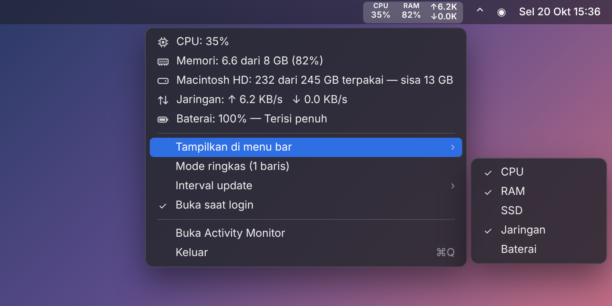
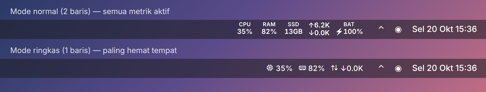

# LiteMonitor

Indikator sistem **ringan** untuk menu bar macOS: CPU, RAM, SSD, jaringan, dan baterai.
Dibuat dengan Swift + AppKit murni, satu file sumber, tanpa dependensi.





> Gambar di atas adalah mockup. Tampilan asli bisa sedikit berbeda.

## Fitur

- CPU, memori (cara hitung sama seperti Activity Monitor), sisa SSD, kecepatan jaringan, baterai
- **Mode normal** (2 baris) atau **mode ringkas** (1 baris, paling hemat tempat)
- Pilih metrik yang tampil di menu bar
- Interval update 1 / 2 / 5 detik
- Buka saat login
- Ikon otomatis mengikuti tema terang/gelap
- Hemat sumber daya: sekitar 15–25 MB RAM, CPU hampir 0%
- Update ke versi terbaru langsung dari menu
- Uninstall langsung dari menu

## Instalasi

**Opsi A: unduh `.app` jadi (tanpa Xcode)**

1. Unduh `LiteMonitor.zip` dari halaman [Releases](../../releases).
2. Ekstrak, lalu pindahkan `LiteMonitor.app` ke folder **Applications**.
3. Karena aplikasi belum ditandatangani Apple, hapus tanda karantina sekali saja:
   ```bash
   xattr -cr /Applications/LiteMonitor.app
   open /Applications/LiteMonitor.app
   ```

**Opsi B: installer (compile di Mac sendiri)**

Butuh Xcode Command Line Tools. Installer akan menawarkan pemasangan kalau belum ada.

```bash
bash ~/Downloads/install-LiteMonitor.command
```

**Opsi C: build dari source**

```bash
git clone https://github.com/kikiraihan/mac-os-lite-monitor.git
cd mac-os-lite-monitor
./scripts/build.sh
cp -R build/LiteMonitor.app /Applications/
```

## Tips: ikon tidak hilang saat menu bar penuh

macOS menyembunyikan ikon yang tidak muat, terutama di MacBook dengan notch.

- Tahan **⌘** lalu seret ikon LiteMonitor ke paling kanan, dekat jam.
- Aktifkan **Mode ringkas**.
- Matikan metrik yang tidak perlu.

## Update

Klik ikon LiteMonitor → **Cek pembaruan…**. LiteMonitor mengecek rilis terbaru di halaman Releases GitHub
(otomatis juga saat dibuka dan sehari sekali; kalau ada versi baru, judul menu berubah jadi
**Update tersedia: vX…**). Pilih **Update sekarang**: file `LiteMonitor.zip` diunduh, `LiteMonitor.app`
lama diganti, lalu aplikasi dibuka lagi. Pengaturan tetap tersimpan.

Kalau aplikasi dijalankan dari folder yang tidak bisa ditulis (atau langsung dari Downloads),
halaman rilis dibuka supaya Anda bisa mengunduh manual.

## Uninstall

Klik ikon LiteMonitor → **Uninstall LiteMonitor…**. LiteMonitor akan dihapus dari "Buka saat login",
pengaturannya dihapus, lalu `LiteMonitor.app` dipindahkan ke Tong Sampah.

Atau manual lewat Terminal:

```bash
pkill -x LiteMonitor
rm -rf /Applications/LiteMonitor.app
defaults delete id.local.litemonitor
```

## Struktur repo

```
LiteMonitor/
├── Sources/LiteMonitor/main.swift   # seluruh kode aplikasi
├── Resources/Info.plist             # metadata bundle (.app)
├── scripts/
│   ├── build.sh                     # build → build/LiteMonitor.app
│   └── make-installer.sh            # buat dist/install-LiteMonitor.command
├── docs/screenshots/                # gambar untuk README
└── .github/workflows/build.yml      # build otomatis di macOS + rilis
```

## Rilis

**Otomatis:** naikkan versi di `Resources/Info.plist` (`CFBundleShortVersionString`, mis. `1.1` → `1.2`),
lalu merge ke `main`. GitHub Actions akan build, membuat tag `v1.2`, dan rilis berisi `LiteMonitor.zip` dan
`install-LiteMonitor.zip`. Kalau versinya tidak diubah, merge hanya di-build tanpa rilis baru.

**Manual:** push tag versi, maka GitHub Actions akan build lalu melampirkan `LiteMonitor.zip` dan `install-LiteMonitor.zip` ke halaman Releases:

```bash
git tag v1.0.0 && git push origin v1.0.0
```

## Syarat

macOS 13 (Ventura) atau lebih baru. Mendukung Apple Silicon dan Intel.
